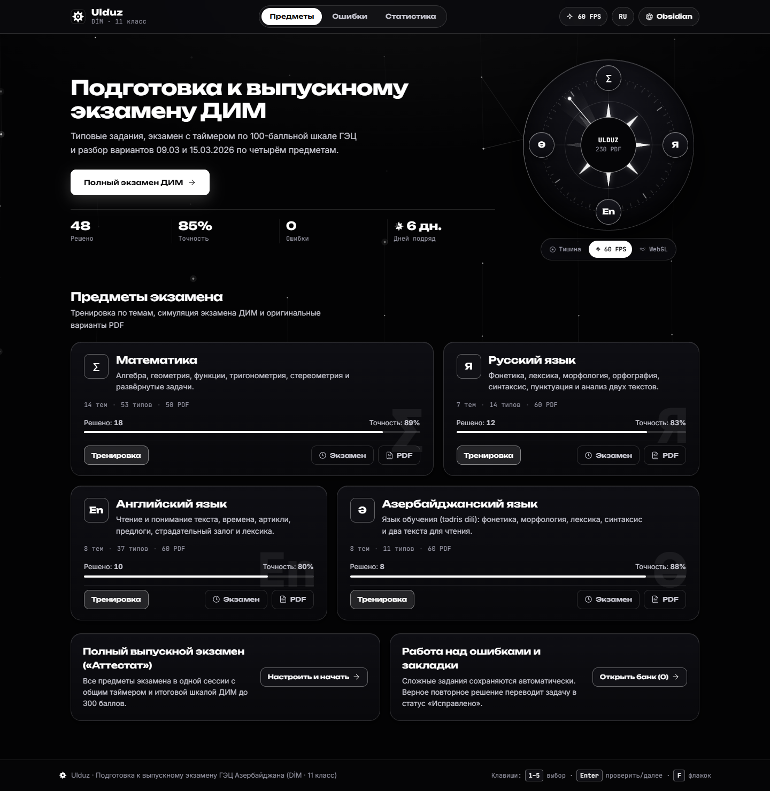
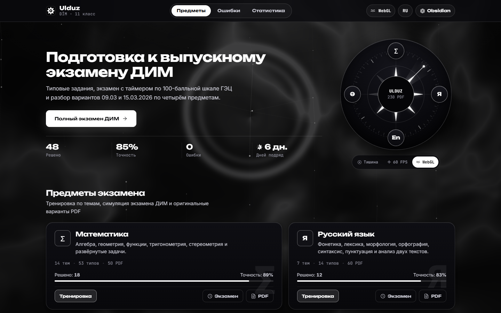
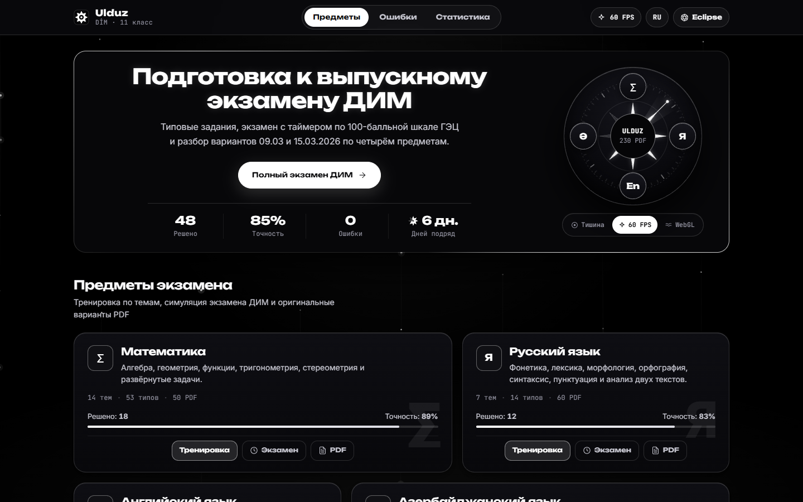
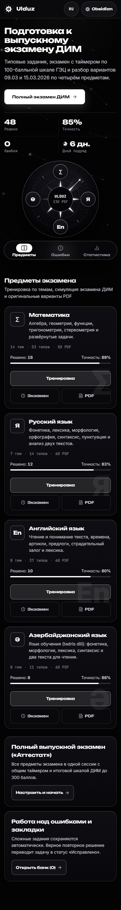
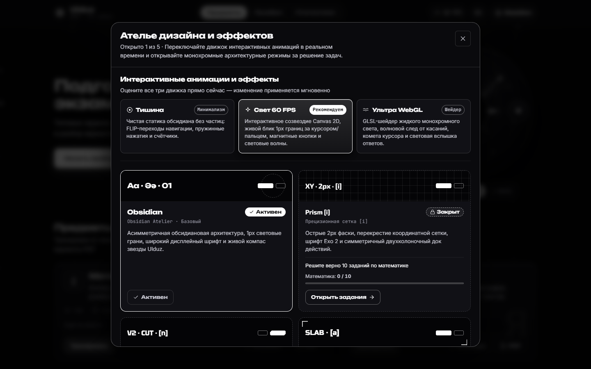
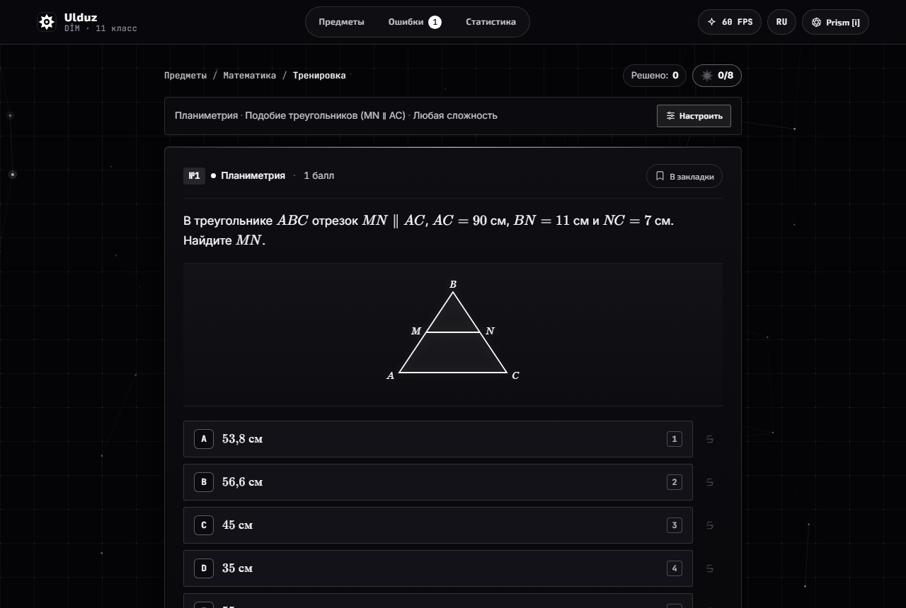

# Ulduz — Тренажёр экзамена DİM «Attestat» (11 класс)

**Ulduz** — бесплатный офлайн-тренажёр для подготовки к выпускному экзамену 11-го класса в Азербайджане (*Tam orta təhsil səviyyəsi üzrə buraxılış imtahanı*, DİM / ГЭЦ). Работает нативно на **Android**, **iOS** (через **Rust + Tauri v2**) и как быстрый веб-/PWA-тренажёр без сервера и регистрации.

> *Free offline exam trainer for Azerbaijan's 11th-grade DİM Buraxılış / Attestat graduation exam — built with a pure Rust + Tauri v2 mobile core (Android & iOS) and a zero-dependency web frontend.*

---

## Возможности

- **4 предмета программы DİM (11 класс):**
  | Предмет | Заданий в билете | Закрытые (1 б.) | Краткий ответ (1 б.) | Письменные (2 б.) | Макс. $W_{\max}$ | Формула 100-балльной шкалы DİM | Генераторов | Оригиналов DİM |
  |---|---:|---:|---:|---:|---:|---|---:|---:|
  | **Математика** (`math`) | 25 | 13 | 5 | 7 | 32 | $\operatorname{round}\!\left(\frac{25}{8} W,\; 1\right)$ | 53 | 50 |
  | **Русский язык** (`ru`) | 30 | 20 | 0 | 10 | 40 | $\operatorname{round}(2.5\, W,\; 1)$ | 14 | 60 |
  | **Английский язык** (`en`) | 30 | 23 | 0 | 7 | 37 | $\operatorname{round}\!\left(\frac{100}{37} W,\; 1\right)$ | 37 | 60 |
  | **Азербайджанский язык** (`az`, *tədris dili*) | 30 | 20 | 0 | 10 | 40 | $\operatorname{round}(2.5\, W,\; 1)$ | 11 | 60 |
  | **Итого** | — | — | — | — | — | 0 штрафных баллов | **115** | **230** |

- **115 параметрических генераторов** с бесконечными новыми вариантами, пошаговыми разборами, локальным рендерингом формул **KaTeX** и векторными чертежами SVG.
- **230 официальных заданий DİM** из весенних сессий **09.03.2026** и **15.03.2026** с разборами и эталонами ответов.
- **Реалистичный режим экзамена:** таймер (60 мин или без таймера), сфокусированный интерфейс без отвлечений, навигация по билету, пометки флажком, самооценка письменных заданий по рубрике DİM (`0 / 0.67 / 1 / 1.33 / 2` и `0 / 1 / 2`), расчёт балла по официальным формулам без штрафов за ошибки.
- **Банк ошибок, закладки и аналитика:** автоматический сбор ошибок по темам, отработка слабых мест, дневная серия, экспорт и импорт прогресса в JSON.
- **Дизайн-система «Obsidian Atelier» (v2.0.0) — чистый чёрно-белый неон и 3 живых FX-движка:**
  - Единая премиальная тёмная монохромная архитектура с интерактивным 8-лучевым оптическим компасом **Ulduz**, асимметричной 12-колоночной витриной предметов и переиспользуемым шаблоном ([DESIGN.md](DESIGN.md), [docs/DESIGN-TEMPLATE.md](docs/DESIGN-TEMPLATE.md)).
  - **3 живых режима интерактивной графики и физики** *(переключаются мгновенно прямо на экране и в Студии)*:
    - **Тишина (`minimal`)** — строгий обсидиан без фоновых canvas-циклов, плавный FLIP-перелёт навигации и одометры цифр.
    - **Свет 60 FPS (`tactile`, по умолчанию)** — интерактивное звёздное созвездие на Canvas-2D с гравитационной линзой курсора, 1px зеркальные блики по граням (`[data-specular]`), магнитные кнопки (`[data-magnetic]`), фотонные кольца касаний (`[data-ripple]`) и ударные импульсы при ответах.
    - **Ультра WebGL (`webgl`)** — кастомный GLSL-шейдер жидкого монохромного света, концентрические волны жидкой ртути на кликах, световой шлейф и супернова-вспышки с адаптивным масштабированием DPR и авто-фолбэком.
  - **5 разблокируемых монохромных архитектурных режимов** (уникальные раскладки кнопок, геометрия, анимации и локальные `.woff2` шрифты со 100% поддержкой кириллицы и азербайджанской латиницы `Əə Ğğ Iı İi Öö Şş Üü Çç`):
    - **Obsidian** *(открыт сразу)* — асимметричное ателье и широкий шрифт **Ulduz Wide**.
    - **Prism [i]** *(за 10 верных задач по математике)* — инженерные фаски 2px, симметричная 2-колоночная панель действий и шрифт **Ulduz Intel**.
    - **Pulse [n]** *(за 5 задач по русскому + 5 по английскому)* — скошенные полигональные кнопки, правосторонний док высокой скорости и шрифт **Ulduz Nvidia**.
    - **Monolith [a]** *(за 10 верных задач по азербайджанскому)* — белые L-образные лазерные скобки, левосторонний док и шрифт **Ulduz AMD**.
    - **Eclipse · Мастер** *(за 100/100 на полном экзамене по предмету или 300/300 за весь экзамен)* — центрированный командный мостик с вращающимся белым плазменным ореолом и широким шрифтом **Ulduz Wide**.
- **Нативная мобильная оболочка (Rust + Tauri v2):**
  - Атомарное сохранение прогресса на диск (`ulduz_progress.json` через `.tmp` + `fsync` + `rename`) и локальный бэкап.
  - Чистый Rust-движок расчёта баллов DİM с полным покрытием unit-тестами.
  - Тактильный отклик (haptics), поддержка системной кнопки «Назад» на Android, safe-area под вырезы и жестовые панели Android/iOS, RU/AZ интерфейс и полная офлайн-работа.

---

## Скриншоты (Obsidian Atelier v2.0.0)

| Главная (Obsidian · 60 FPS) | Главная (WebGL · Жидкий свет) | Режим Eclipse · Мастер |
|---|---|---|
|  |  |  |

| Мобильная версия (390px) | Студия режимов и FX | Математика — SVG-чертёж |
|---|---|---|
|  |  |  |

---

## Скачать и установить на Android

1. Откройте раздел **[Releases](https://github.com/nakoulaf4/ulduz-attestat/releases)** репозитория.
2. Скачайте файл `Ulduz-v2.0.0-android-arm64.apk` (или универсальный APK из CI Artifacts).
3. На телефоне откройте скачанный `.apk` и при первом запуске разрешите установку приложений из этого источника (*«Установка из неизвестных источников»*).
4. После установки тренажёр работает **полностью офлайн** — интернет не требуется.

---

## Сборка из исходного кода

### Предварительные требования

- **Rust** (stable, `rustup` + `cargo`)
- **Node.js** 20+ (только для CLI Tauri и автотестов)
- Для **Android**:
  - **JDK 17** (`JAVA_HOME`)
  - **Android SDK** (`ANDROID_HOME`, API 35, `build-tools;35.0.0`) и **NDK 27+** (`NDK_HOME`)
  - Rust-таргеты:
    ```bash
    rustup target add aarch64-linux-android armv7-linux-androideabi
    ```
- Для **iOS** (только macOS + Xcode):
  - Rust-таргеты:
    ```bash
    rustup target add aarch64-apple-ios aarch64-apple-ios-sim
    ```

### Установка зависимостей и тесты

```bash
npm install

# Проверка 115 генераторов (115 000 задач), 80 полных экзаменов и 230 оригиналов DİM
node tools/selftest.mjs --count 1000 --exams 20

# Проверка Rust-ядра (scoring + atomic storage) и clippy
cd src-tauri
cargo test
cargo clippy --all-targets -- -D warnings
```

### Сборка Android APK

```bash
# Инициализация Android-проекта (если ещё не выполнен)
npm run android:init

# Сборка релизного APK под ARM64 (или universal для ARM64 + ARMv7)
npm run android:build
```

Готовый APK появится в `src-tauri/gen/android/app/build/outputs/apk/`. Для установки на телефон подпишите релизный APK своим keystore через `apksigner` (или используйте debug/CI-подпись, как в `.github/workflows/mobile-build.yml`).

### Сборка iOS (macOS + Xcode)

```bash
npm run ios:init
npm run ios:build
```

GitHub Actions (`.github/workflows/mobile-build.yml`) автоматически собирает и проверяет Rust-тесты, Android APK (`ubuntu-latest`) и неподписанный iOS `.ipa` (`macos-latest`) при каждом коммите в `main`.

---

## Локальный запуск веб-/PWA-версии

Фронтенд в `site/` — чистые ES-модули без сборщика. Достаточно запустить любой статический HTTP-сервер:

```bash
python -m http.server 8123 --directory site
```

Затем откройте `http://127.0.0.1:8123/` в браузере (поддерживается установка как PWA и офлайн-работа через Service Worker).

---

## Структура проекта

```text
site/                       # Статический фронтенд (HTML, CSS, ES modules, KaTeX, 115 генераторов, 230 оригиналов)
src-tauri/                  # Нативное Rust-ядро Tauri v2 (Android + iOS + Desktop)
  src/scoring.rs            # Официальный движок расчёта баллов DİM 11-го класса + unit-тесты
  src/storage.rs            # Атомарное файловое хранилище прогресса и экспорт + unit-тесты
  src/lib.rs                # Точка входа Tauri v2 (mobile_entry_point + haptics + IPC-команды)
  capabilities/             # Права доступа Tauri v2 (desktop + mobile haptics)
  gen/android/              # Android-проект Gradle + MainActivity.kt (edge-to-edge и кнопка «Назад»)
tools/                      # Автотесты (selftest.mjs, e2e.mjs) и отчёты проверки качества
docs/                       # Исследование регламента DİM и спецификация дизайна
.github/workflows/          # CI/CD для Rust-тестов, Android APK и iOS IPA
```
