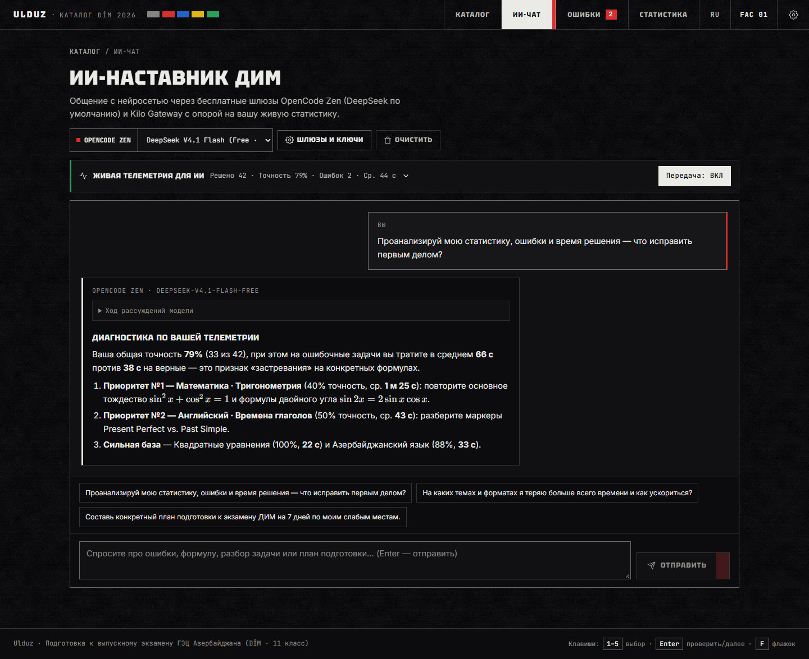
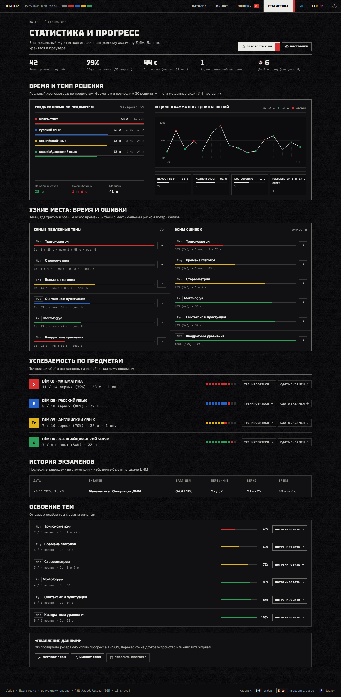
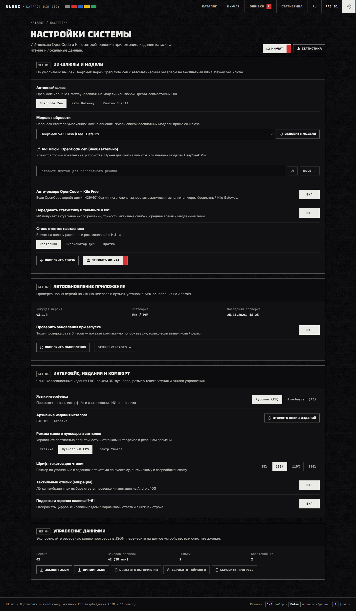
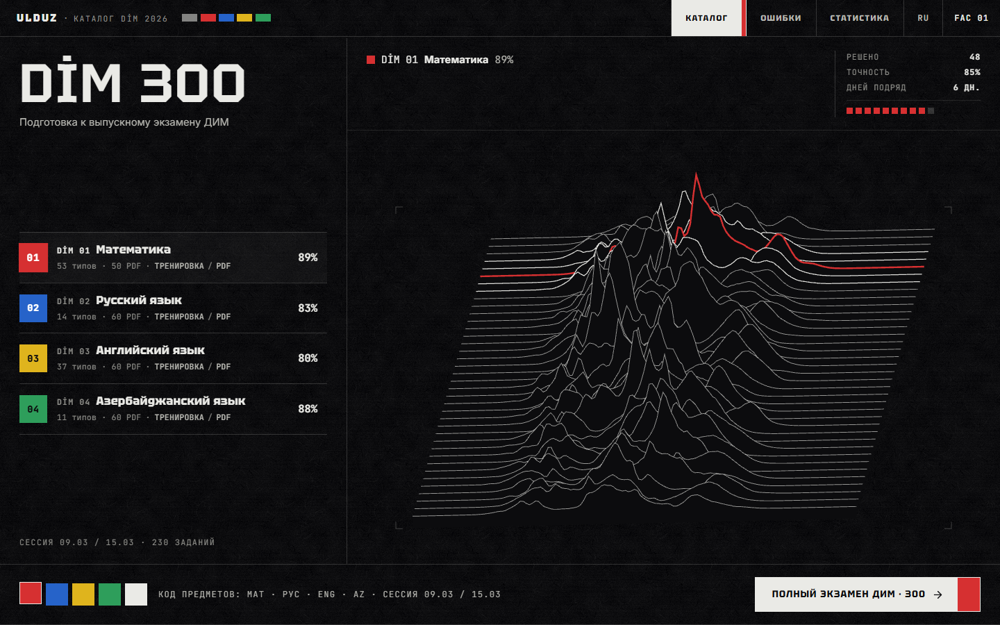
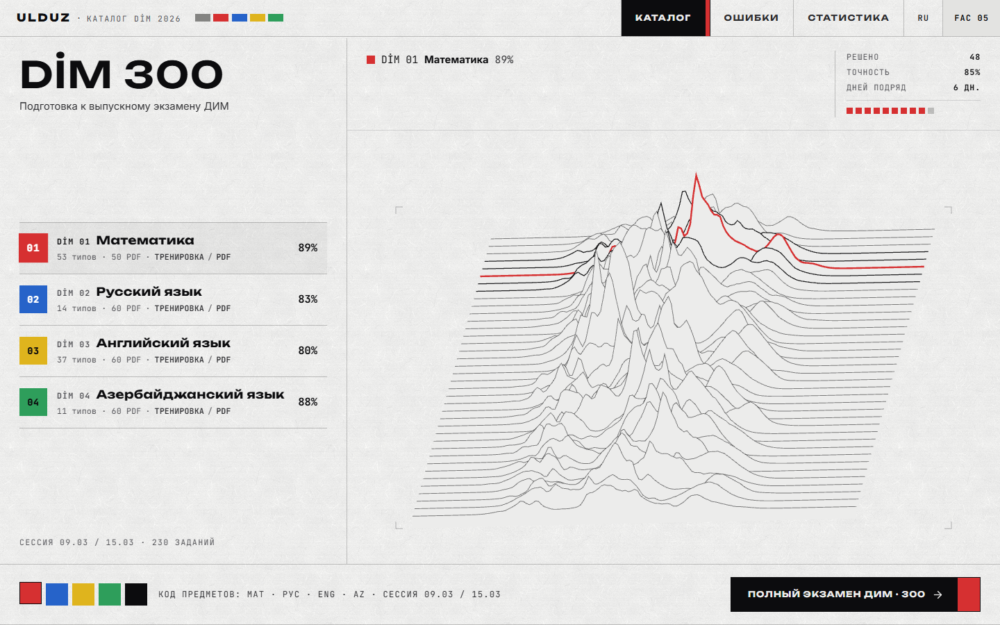
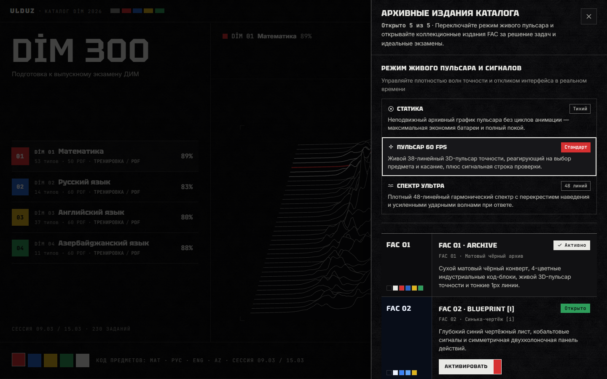
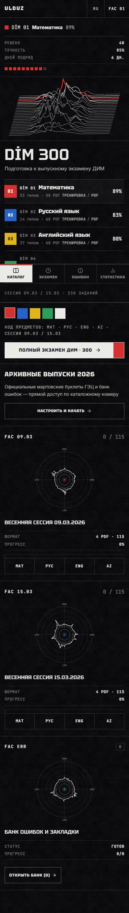
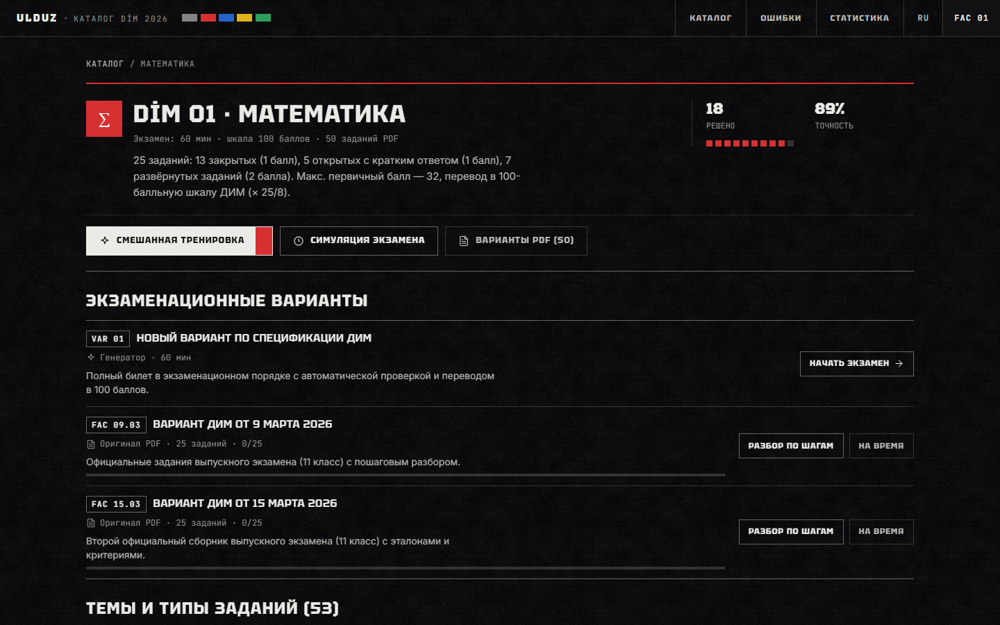
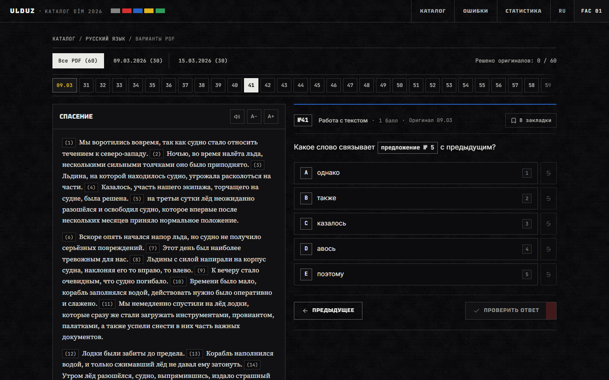

# Ulduz — Тренажёр экзамена DİM «Attestat» (11 класс)

**Ulduz** — бесплатный офлайн-тренажёр для подготовки к выпускному экзамену 11-го класса в Азербайджане (*Tam orta təhsil səviyyəsi üzrə buraxılış imtahanı*, DİM / ГЭЦ). Работает нативно на **Android**, **iOS** (через **Rust + Tauri v2**) и как быстрый веб-/PWA-тренажёр без сервера и регистрации.

> *Free offline exam trainer for Azerbaijan's 11th-grade DİM Buraxılış / Attestat graduation exam — built with a pure Rust + Tauri v2 mobile core (Android & iOS) and a zero-dependency archival web frontend.*

---

## Возможности

- **4 предмета программы DİM (11 класс):**
  | Каталог | Предмет | Заданий | Закрытые (1 б.) | Краткий (1 б.) | Письменные (2 б.) | Макс. $W_{\max}$ | Формула 100-балльной шкалы DİM | Генераторов | Оригиналов |
  |---|---|---:|---:|---:|---:|---:|---|---:|---:|
  | `DİM 01` | **Математика** (`math`) | 25 | 13 | 5 | 7 | 32 | $\operatorname{round}\!\left(\frac{25}{8} W,\; 1\right)$ | 53 | 50 |
  | `DİM 02` | **Русский язык** (`ru`) | 30 | 20 | 0 | 10 | 40 | $\operatorname{round}(2.5\, W,\; 1)$ | 14 | 60 |
  | `DİM 03` | **Английский язык** (`en`) | 30 | 23 | 0 | 7 | 37 | $\operatorname{round}\!\left(\frac{100}{37} W,\; 1\right)$ | 37 | 60 |
  | `DİM 04` | **Азербайджанский язык** (`az`) | 30 | 20 | 0 | 10 | 40 | $\operatorname{round}(2.5\, W,\; 1)$ | 11 | 60 |
  | — | **Итого** | — | — | — | — | — | 0 штрафных баллов | **115** | **230** |

- **115 параметрических генераторов** с бесконечными новыми вариантами, пошаговыми разборами, локальным рендерингом формул **KaTeX** и векторными чертежами SVG.
- **230 официальных заданий DİM** из весенних сессий **09.03.2026** (`FAC 09.03`) и **15.03.2026** (`FAC 15.03`) с разборами и эталонами ответов.
- **Реалистичный режим экзамена:** таймер (60 мин или без таймера), сфокусированный режим без отвлечений, выдвижная сетка билета, пометки флажком, самооценка письменных заданий по рубрике DİM (`0 / 0.67 / 1 / 1.33 / 2` и `0 / 1 / 2`), расчёт балла по официальным формулам без штрафов за ошибки.
- **Встроенный ИИ-наставник ДИМ (`#/ai`) и бесплатные шлюзы OpenCode Zen & Kilo Gateway (v3.1.0):**
  - По умолчанию активна модель **DeepSeek (`deepseek-v4.1-flash-free`)** через **OpenCode Zen** с автоматическим резервным переключением на полностью бесплатный **Kilo Gateway (`kilo-auto/free`)** без ключа и поддержкой личных API-ключей, обновления живого каталога `/models` и любых OpenAI-совместимых серверов.
  - На Android и Desktop все ИИ-запросы идут через нативный Rust-мост `reqwest` (`rustls-tls`) без браузерных CORS-ограничений.
  - **Живая телеметрия ученика:** нейросеть автоматически получает актуальные данные о количестве решённых задач, точности, активных ошибках, среднем времени на верный/ошибочный ответ, самых медленных темах и форматах, плюс контекст конкретной задачи по кнопке **«Спросить ИИ»** прямо из разбора.
  - Поддержка рендеринга математических формул **KaTeX** и сворачиваемого блока «Ход рассуждений модели».
- **Визуальная аналитика времени и ошибок (`#/stats`, v3.1.0):**
  - Точный хронометраж активного времени решения каждой задачи во всех режимах (тренировка, PDF-оригиналы, работа над ошибками и экзамен).
  - График **«Осциллограмма последних решений»** (SVG до 30 последних задач с линией среднего темпа и узлами верности), полосы среднего времени по предметам (`DİM 01`–`04`), сравнение темпа верных и ошибочных ответов, скорость по форматам и двухколоночный разбор **«Самые медленные темы / Зоны ошибок»**.
- **Автообновление и единый экран настроек (`#/settings`, v3.1.0):**
  - Тихая автопроверка новых релизов на GitHub Releases + ручная проверка, отображение чейнджлога, потоковая загрузка APK в `cacheDir/updates/` с индикатором прогресса и прямой запуск системного установщика Android через `FileProvider`.
  - Кнопка настроек (`⚙`) в шапке объединяет управление ИИ-шлюзами/ключами/стилем наставника, автообновлением, языком, архивными изданиями, режимом пульсара, масштабом шрифта чтения, тактильной вибрацией, подсказками клавиш и резервными копиями.
- **Банк ошибок, закладки и аналитика:** автоматический сбор ошибок по темам, последовательная работа над ошибками, дневная серия, экспорт и импорт прогресса в JSON.
- **Новая дизайн-система «Factory Records Archival Catalog» (v3.0.0):**
  - Полная переработка с нуля без шаблонных карточек и скруглений (`0px`): тактильный матовый чёрный картон (`#0C0C0E` + бесшовная растровая текстура `matte-stock-dark.png`), тёплые типографские чернила (`#EAEAE6`), 1px архитектурные линии и 4 индустриальных цветовых кода Peter Saville (`#D63031` Математика, `#2663C9` Русский, `#DFB41D` Английский, `#2E9E5B` Азербайджанский).
  - **Интерактивный 3D-пульсар точности (`mountHomePulsar`):** наклонный аксонометрический хребет в духе CP1919 на Canvas-2D, реагирующий на выбор предмета, нижний цветовой декодер и клики, с тремя режимами плотности (`Статика`, `Пульсар 60 FPS`, `Спектр Ультра 48 линий`).
  - **Высокочастотные полярные спектры (`196px`) и колофоны телеметрии:** реальный прогресс мартовских буклетов `FAC 09.03` / `FAC 15.03`, 10-блочные индикаторы сигнала и верхняя 2px полоса передачи импульса при проверке ответов.
  - **5 разблокируемых архивных изданий** в правой выдвижной панели (уникальные палитры, раскладки панели действий и локальные `.woff2` шрифты со 100% покрытием кириллицы и азербайджанской латиницы `Əə Ğğ Iı İi Öö Şş Üü Çç`):
    - **`FAC 01 · Archive`** *(открыто сразу)* — матовый чёрный архив, квадратно-угловой гротеск `Tektur`, 4-цветные плашки и красный кейкап CTA.
    - **`FAC 02 · Blueprint [i]`** *(за 10 верных задач по математике)* — глубокая чертёжная синька `#080D18`, симметричный 2-колоночный док и `Ulduz Intel`.
    - **`FAC 03 · Haçienda [n]`** *(за 5 задач по русскому + 5 по английскому)* — угольно-жёлтая эстетика Манчестера `#F0C419`, скошенные кнопки и правосторонний док.
    - **`FAC 04 · Crimson [a]`** *(за 10 верных задач по азербайджанскому)* — тяжёлый графит с красными угловыми приводными метками, левосторонний док и `Ulduz AMD`.
    - **`FAC 05 · Master Press`** *(за 100/100 на полном экзамене по предмету или 300/300 за весь экзамен)* — инвертированный дневной конверт из прохладного архивного хлопка (`#ECECEB` + `matte-stock-light.png`) и широкий шрифт `Ulduz Wide`.
  - Документация и шаблон для расширения: [DESIGN.md](DESIGN.md), [docs/DESIGN-TEMPLATE.md](docs/DESIGN-TEMPLATE.md).
- **Нативная мобильная оболочка (Rust + Tauri v2):**
  - Атомарное сохранение прогресса на диск (`ulduz_progress.json` через `.tmp` + `fsync` + `rename`) и локальный бэкап.
  - Чистый Rust-движок расчёта баллов DİM с полным покрытием unit-тестами.
  - Тактильный отклик (haptics), поддержка системной кнопки «Назад» на Android, safe-area под вырезы и жестовые панели Android/iOS, полная локализация RU/AZ и автономная офлайн-работа.

---

## Скриншоты (Factory Records Catalog v3.1.0)

| ИИ-наставник (`#/ai · DeepSeek`) | Визуальная статистика и осциллограмма (`#/stats`) | Единые настройки (`#/settings`) |
|---|---|---|
|  |  |  |

| Главная (`FAC 01 · Archive`) | Дневное издание (`FAC 05 · Master Press`) | Панель архивных изданий |
|---|---|---|
|  |  |  |

| Мобильная версия (`390px`) | Каталог предмета (`DİM 01`) | Чтение и разбор PDF (`FAC 09.03`) |
|---|---|---|
|  |  |  |

---

## Скачать и установить на Android

1. Откройте раздел **[Releases](https://github.com/nakoulaf4/ulduz-attestat/releases)** репозитория.
2. Скачайте файл `Ulduz-v3.1.0-android-arm64.apk` (или универсальный APK из CI Artifacts).
3. На телефоне откройте скачанный `.apk` и при первом запуске разрешите установку приложений из этого источника (*«Установка из неизвестных источников»*).
4. После установки тренажёр работает **полностью офлайн** — интернет не требуется.

---

## Сборка из исходного кода

### Предварительные требования

- **Rust** (stable, `rustup` + `cargo`)
- **Node.js** 20+ (только для CLI Tauri и автотестов)
- Для **Android**:
  - **JDK 17** (`JAVA_HOME`)
  - **Android SDK** (`ANDROID_HOME`, API 35, `build-tools;35.0.0`) и **NDK 27+** (`NDK_HOME`)
  - Rust-таргеты:
    ```bash
    rustup target add aarch64-linux-android armv7-linux-androideabi
    ```
- Для **iOS** (только macOS + Xcode):
  - Rust-таргеты:
    ```bash
    rustup target add aarch64-apple-ios aarch64-apple-ios-sim
    ```

### Установка зависимостей и тесты

```bash
npm install

# Проверка 115 генераторов (23 000+ задач), экзаменов и 230 оригиналов DİM
node tools/selftest.mjs --count 200 --exams 4

# Полный Playwright E2E, мобильный и 5-темный аудит (26/26)
node tools/e2e.mjs

# Проверка Rust-ядра (scoring + atomic storage) и clippy
cd src-tauri
cargo test
cargo clippy --all-targets -- -D warnings
```

### Сборка Android APK

```bash
npm run android:init
npm run android:build
```

Готовый APK появится в `src-tauri/gen/android/app/build/outputs/apk/`. Для установки на телефон подпишите релизный APK своим keystore через `apksigner` (или используйте debug/CI-подпись, как в `.github/workflows/mobile-build.yml`).

### Сборка iOS (macOS + Xcode)

```bash
npm run ios:init
npm run ios:build
```

GitHub Actions (`.github/workflows/mobile-build.yml`) автоматически собирает и проверяет Rust-тесты, Android APK (`ubuntu-latest`) и неподписанный iOS `.ipa` (`macos-latest`) при каждом коммите в `main`.

---

## Локальный запуск веб-/PWA-версии

Фронтенд в `site/` — чистые ES-модули без сборщика. Достаточно запустить любой статический HTTP-сервер:

```bash
python -m http.server 8123 --directory site
```

Затем откройте `http://127.0.0.1:8123/` в браузере (поддерживается установка как PWA и офлайн-работа через Service Worker).

---

## Структура проекта

```text
site/                       # Статический фронтенд (HTML, CSS, ES modules, KaTeX, 115 генераторов, 230 оригиналов)
  assets/textures/          # Бесшовные растровые тайлы матового картона (dark/light)
src-tauri/                  # Нативное Rust-ядро Tauri v2 (Android + iOS + Desktop)
  src/scoring.rs            # Официальный движок расчёта баллов DİM 11-го класса + unit-тесты
  src/storage.rs            # Атомарное файловое хранилище прогресса и экспорт + unit-тесты
  src/lib.rs                # Точка входа Tauri v2 (mobile_entry_point + haptics + IPC-команды)
  capabilities/             # Права доступа Tauri v2 (desktop + mobile haptics)
  gen/android/              # Android-проект Gradle + MainActivity.kt (edge-to-edge и кнопка «Назад»)
tools/                      # Автотесты (selftest.mjs, e2e.mjs) и отчёты проверки качества
docs/                       # Регламент DİM и шаблон дизайн-системы Factory Records
DESIGN.md                   # Каноническая дизайн-система (+ .impeccable/design.json)
.github/workflows/          # CI/CD для Rust-тестов, Android APK и iOS IPA
```
